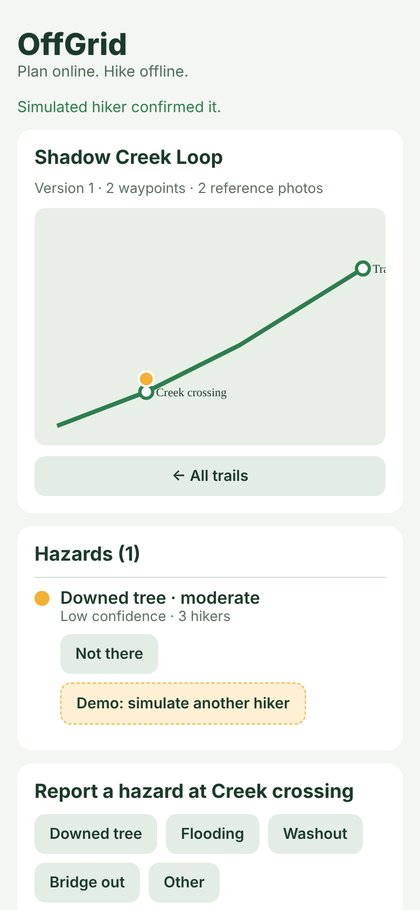
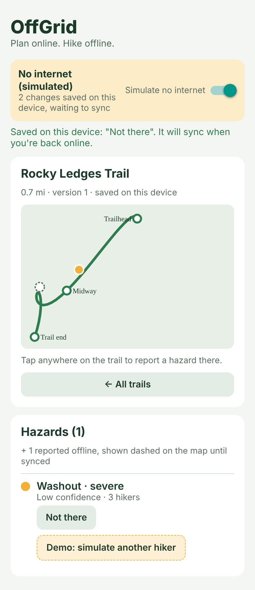
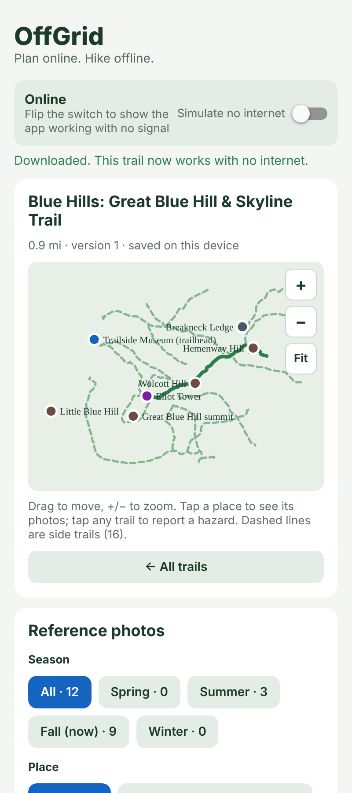
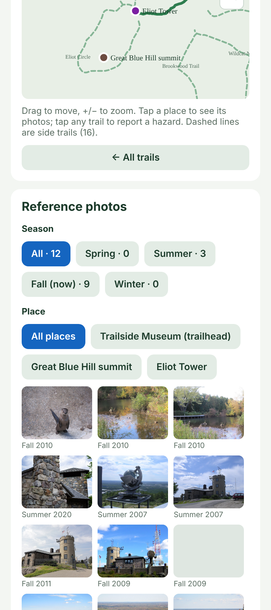
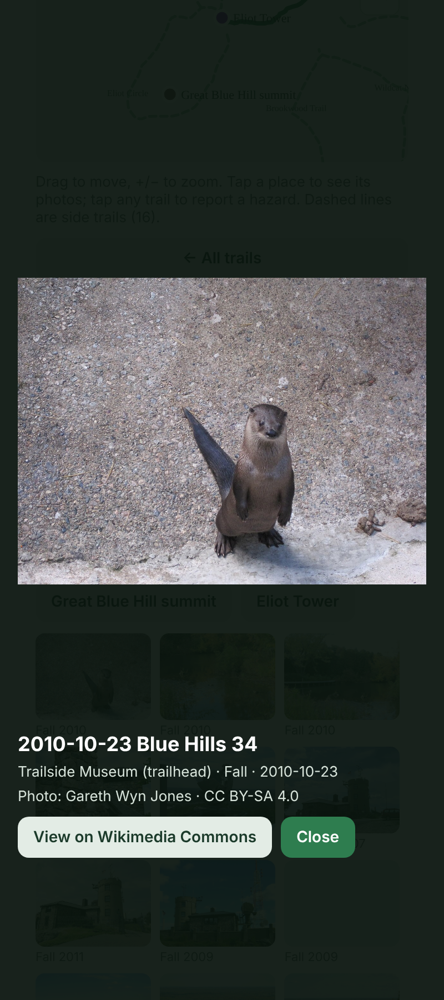

# Handoff: where OffGrid is (2026-11-24)

Read this first if you're picking the project up. Rules for changing anything:
log it in `CHANGELOG.md`, follow the Ironhide protocol (every bug fix gets a
regression test), run `npm run check`, and work on a branch and open a pull
request into `main` (the project lead reviews and decides releases). AI tools:
see `AGENTS.md`.

## What works today (all verified)

- **Backend API** (`backend/`): trails, offline trip packages, photo uploads
  (sanitized), hazard reports with Waze-style confidence tiers, reviewer
  endpoints. 127 automated tests.
- **`npm run demo`**: starts the real API, walks through a hiker's day
  (plan, download, report a hazard, others confirm it, upload a photo, bad
  input refused), then stops the server. Run this first to see it work.
- **Phone app skeleton** (`app/`, Expo SDK 58): disclaimer, trail list, trip
  download, route drawing with hazards colour-coded by confidence tier,
  report a hazard, "Not there", and a **"Demo: simulate another hiker"**
  button. Tested in a browser against the real API.

- **Add trails live from OpenStreetMap**: type a trail name ("Rocky Ledges")
  and it's pulled in, stitched into a route, and ready to download.
- **Tap the map to drop a hazard** anywhere on the trail.
- **"Simulate no internet"**: no network calls at all; downloaded trails still
  work; reports are saved on the device and sync when you switch back.

 

- **Blue Hills (Great Blue Hill)**: a real trail network with side trails and
  places, an interactive map (zoom, drag, tap a place), and seasonal
  reference photos with credits. Rebuild the data with `npm run data:blue-hills`
  (needs internet; uses OpenStreetMap and Wikimedia Commons politely).

  

## Class demo run-sheet (Dec 9)

1. Start everything (`npm run preview`, or Expo Go on phones) **with internet**.
2. Ask the class for trails they like around Wellesley. Type each into
   **Add a trail**. Each appears in the list with its distance.
3. Open one: it downloads and draws the route.
4. Tap the trail to report a hazard, then press **Demo: simulate another
   hiker** a few times and watch confidence climb (very low, low, medium).
5. **Plan by voice:** tap 🎤 Speak (browser) or the keyboard's mic (phone)
   and say "I'm about to hike Blue Hills this Saturday, can you plan a trip
   for me?". The app downloads the trail and its photos, switches to that
   season's photos, and replies in text that it's ready to use offline. Speaking
   twice adds to the sentence. (Or just open
   **Blue Hills**: it downloads the trail and saves its photos either way.)
   A green **"You're ready to hike"** checklist appears (map, photos saved,
   places "Where am I?" can match, hazards checked) with the reminder to keep
   the app open in the background if signal drops. Point out the red **Keep
   OffGrid open** banner.
   To show the follow-up questions, say something vague ("plan something
   nice for Sunday"): OffGrid asks which trail, and if it can't find it near
   Wellesley, what town and state it's in ("It's in Canton, Massachusetts").
   Or ask **"I'm looking for a hiking place near Needham"**: OffGrid lists the
   trails within 5 miles with length, time and difficulty. Tap **Hardest** /
   **Longest** / **Quickest** (or say it), then "number 2" or **Plan this**.
6. Press **Go offline** (top). The banner shows "Internet requests blocked:
   N · sent: 0". For the strongest proof on a phone, also switch on airplane
   mode. Only downloaded trails are listed; the map and photos still work.
7. **Where am I?** Take or choose a photo of a landmark: the app answers
   "Probably Eliot Tower, 9x% (high)" with the closest reference photo next
   to yours. If it's unsure it asks for another photo. Share it as a reference
   photo: it waits on the device ("waiting to upload").
8. Report a hazard and tap "Not there" too; the banner counts what's waiting.
9. Press **Back online**: "synced N changes", and everything uploads.

How good is "Where am I?" Tested by hiding each real Blue Hills photo and
asking the app to place it from the others: 10 of 11 right (the miss was
"observation tower" vs Eliot Tower, the same tower). It works best on
distinctive landmarks (towers, signs, views); a generic patch of woods will
come back as low confidence, which is the honest answer.

Tips: test the trail names you expect beforehand (OpenStreetMap names vary,
e.g. "Brook Path" vs "Fuller Brook Path"). If a name isn't found, try a
shorter part of it. The real OpenStreetMap import has only been tested
against sample data in the Claude session (it can't reach OpenStreetMap), so
**try it on a laptop before the demo.**

## Run it

You need Node 20+.

```bash
npm install
npm run check      # typecheck + all tests
npm run demo       # scripted end-to-end walkthrough
```

### Quickest way to try the app: in your browser

One address serves both the app and the API (no phone or Wi-Fi setup):

```bash
cd app
npm install
npm run build:web
cd ..
npm run preview
```

Open http://localhost:8080. It stops by itself after 30 minutes
(`npm run preview -- --minutes 60` for longer). Data resets when it stops.
Re-run `npm run build:web` after changing the app.

### If `npm run build:web` stops after "Starting Metro Bundler"

It must end with **"Exported: dist"**. If it stops silently:

1. Make sure the app's packages are up to date: `cd app` then `npm install`.
2. Build again with the cache cleared and the hidden error shown:

   PowerShell:
   ```powershell
   $env:EXPO_DEBUG="1"; npx expo export --platform web --clear
   ```
   Mac/Linux:
   ```bash
   EXPO_DEBUG=1 npx expo export --platform web --clear
   ```
3. If it still fails, copy what it prints into a new BUG entry in `docs/BUGS.md`.

### The app on your phone (Expo Go)

1. Install **Expo Go** from the App Store or Play Store.
2. Laptop and phone on the **same Wi-Fi**. Find your laptop's IP
   (Windows: `ipconfig` → "IPv4 Address"; Mac: `ipconfig getifaddr en0`).
3. Terminal 1: start the API: `npm run dev:backend` (port 4000).
   On Windows, allow Node through the firewall when asked.
4. Terminal 2, in the `app` folder:

   ```bash
   cd app
   npm install
   ```

   Then set the API address to your laptop's IP and start Expo.

   PowerShell:
   ```powershell
   $env:EXPO_PUBLIC_API_URL="http://192.168.1.20:4000"; npx expo start
   ```
   Mac/Linux:
   ```bash
   EXPO_PUBLIC_API_URL=http://192.168.1.20:4000 npx expo start
   ```
5. Scan the QR code (iPhone: Camera app; Android: inside Expo Go).

Can't connect? Check the IP is the laptop's, not `localhost`, and that both
devices are on the same network. University Wi-Fi often blocks
device-to-device traffic: use a phone hotspot or `npx expo start --tunnel`.

### The app in a browser

```bash
npm run dev:backend
```

```bash
cd app
npx expo start --web
```

The API only accepts browser requests from `http://localhost:8081` by
default. For any other address, set `OFFGRID_CORS_ORIGINS` on the backend.

## Not done yet: next tasks, in priority order

Pick one, put your name on it in the team chat, branch, and open a PR.

1. **Try the live OpenStreetMap import against the real thing** on a laptop
   (the Claude session can't reach it). Type the candidate Wellesley trails
   (Brook Path, Centennial Reservation, Rocky Ledges, Elm Bank, Sudbury
   Aqueduct), check the routes against the town's trail maps, and note which
   names work. Tune `IMPORT_BBOX` or the matching in
   `backend/src/services/osmImportService.ts` if needed. Behind a proxy, run
   the backend with `NODE_USE_ENV_PROXY=1`.
2. **Live GPS on the trail** (`expo-location`): show "you are here" on the
   route, feed fixes to `OfflineNavigator` (`mobile/src/core`) for on/off-route
   and "approaching hazard → Still there?" prompts. Using the shared mobile
   code from the app needs a `metro.config.js` with `watchFolders` pointing at
   `../mobile` and `../packages`.
3. **Real offline storage**: save the downloaded package on the phone
   (`expo-file-system`) by implementing `StorageAdapter`, so the trail works
   in airplane mode. This is the core of the demo.
4. **Supabase** (needs one teammate's free account): create a project, turn
   on anonymous sign-in, add tables for hazards, votes and contributions,
   and replace the in-memory stores in `backend/src/services/`. Without it,
   all hazards disappear whenever the server restarts.
5. **Camera + photo matching spike**: check whether a ready-made model
   (e.g. MobileNet via TensorFlow.js) runs inside Expo Go. If not, match on
   the server when online (see `ROADMAP.md`).
6. **Real map tiles** (`react-native-maps`, works in Expo Go) to replace the
   drawn route.
7. **Face blurring** for uploaded photos (open-source face detection on the
   server; reject photos where people are the main subject).
8. **Deploy the API** to Render's free tier for the demo.

## Known issues and limits

- "Couldn't reach OpenStreetMap": OpenStreetMap's free servers are often
  busy. OffGrid now tries the main server and two mirrors, and the message
  says which failed and why (also printed in the `npm run preview`
  terminal as `[OpenStreetMap] …`). That message is never offline mode;
  offline mode only changes with the Go offline / Back online button.

- Nearby-trail **difficulty is an estimate** from length and OpenStreetMap's
  own difficulty tags; there's no elevation data yet. Adding elevation
  (e.g. a free elevation API or USGS 3DEP) would make it much more accurate.
  Times assume about 2 mph, slower for harder trails.
- The nearby search was tested here with stand-ins for OpenStreetMap
  (unreachable from the Claude session). **Try "hiking places near Needham"
  on a laptop** before the demo; real results include whatever named paths
  are mapped, so some may be short town paths.

- The planner's town lookup uses OpenStreetMap's Nominatim geocoder. It was
  tested here with stand-in services only (the Claude session can't reach
  OpenStreetMap's search servers), so **try a real follow-up on a laptop**
  before the demo, e.g. "Ponkapoag Pond", then "Canton, Massachusetts".

- Voice planning understands simple requests (a trail name plus today,
  tomorrow, a weekday, "this weekend", "next week" or a month). It's keyword
  rules, not an AI assistant. The browser mic needs Chrome, Edge or Safari;
  on phones use keyboard dictation.
- The leave-page prompt is a browser feature: browsers only show it after
  you've interacted with the page, and phones can't block closing an app,
  which is why the banner exists.

- "Where am I?" uses a simple built-in image fingerprint, not a trained AI
  model (none can run offline in Expo Go). It's swappable via
  `EmbeddingAdapter`; a real model (e.g. MobileNet) needs a custom app build.
- Photos shared from "Where am I?" become references only after the usual
  review (2 hikers at the same place, or a reviewer). The server doesn't yet
  record the match confidence with the photo.
- Downloads, saved photos and the offline queue live in memory: closing the
  app loses them (real on-device storage is still a next task).

- Blue Hills photos: Wikimedia Commons only had dated **summer and fall**
  photos for these places, so spring and winter show "no photos yet". Add
  more by contributing photos, or by curating others into the data.
  Some photos are more "trailhead life" (an otter at the museum) than
  landmark views; curate in `backend/scripts/buildBlueHills.ts`.
- Photos load from Wikimedia, so with no real signal they only show if
  already loaded. Next step: download thumbnails into the trip package.
- The Skyline Trail is several disconnected pieces in OpenStreetMap; the
  longest one is drawn as the main route and the rest as side trails.

- The hiker ID changes each time the app starts (sign-in is task 4).
- Hazards are placed where you tap the trail, not from the phone's GPS yet (task 2).
- Downloaded trails and the offline queue live in memory: closing the app loses them (task 3).
- Imported trails have no elevation data and generated waypoints (trailhead/midway/end).
- The app has no automated tests yet. CI typechecks it.
- `npm audit` in `app/` shows 3 moderate advisories in Expo's build tooling
  (a `minimatch` denial-of-service issue), not in code shipped to phones.
  The fix needs a breaking Expo upgrade; revisit at the next Expo SDK.
- The Claude cloud session can't reach OpenStreetMap or Expo's servers yet,
  which is why task 1 is listed for a laptop.
